# Changelog

All notable changes to ICE RIOT. Screenshots are from real games (AI vs AI on a local server) and the
built-in demo mode (`?demo=lobby|game|final|menu`).

- [v0.2.0](#v020--2026-11-22) - goalies, goal-cam replays, glass-smash picture-in-picture, the UI redesign
- [v0.1.0](#v010--2026-11-21) - the first playable release

---

## v0.2.0 · 2026-11-22

The biggest update yet: new animated goalies, a new arcade camera that follows your skater, cinematic
goal replays from inside the net, picture-in-picture glass smashes, a full UI redesign with a phone
lobby, a living LED arena, mouse controls and secret challenges.

The server and the network protocol are unchanged, so this is a client and shared-sim release. Players
load the game from the host, so updating the host is all it takes; have everyone reload (Ctrl+F5).
Old saves and settings load and migrate automatically.

  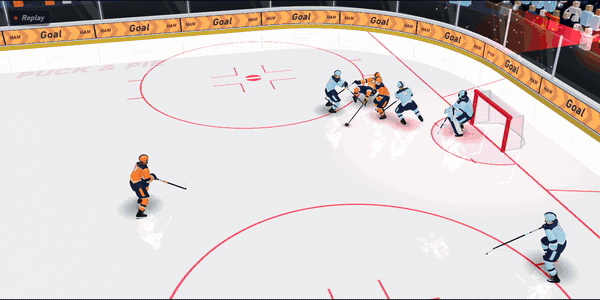
   A real goal replay: the run-up, a hard cut to the goal cam inside the net, 0.35x slow motion, then the 0.15x finish as the goalie dives too late.

### Highlights

- **Animated goalies.** Both goalies are now rigged, animated models with pads, a mask, a blocker and a catching glove. They have 15 clips, and each save is picked from where the puck meets them: butterfly, glove, blocker or pad stretch.
- **Goals beat the goalie fair and square.** A goal now goes past the goalie's body, or he slides the wrong way. It no longer passes straight through him: over 40 AI games that dropped from 77% of goals to 2%, with scoring unchanged.
- **A new arcade camera.** A lower, closer side view now follows the skater *you* control, and a new puck indicator points to the puck when it is away from you or off screen.
- **Cinematic goal replays.** Replays show a 6 s run-up, then slow motion from the windup and an extra-slow finish as the puck goes in. They are shot from a new **goal cam** inside the net, or from an optional **puck cam**, with a caption naming the scorer and the assist.
- **Glass-smash replays in picture-in-picture.** Shatter the glass and, a moment later, a small corner screen replays the hit in slow motion while play goes on.
- **Head indicators over the players.** Your plate floats over your skater with your slot badge, name, turbo and slap-charge bars and on-fire status. It replaces the old bottom-left HUD panel.
- **Mouse controls.** Left click shoots and right click passes, and mouse buttons can be rebound like any key.
- **A full UI redesign.** The lobby, HUD, callouts, pause menu, final screen, settings, challenges, leaderboard, chat, tutorial hints, fight overlay and touch controls all have a new look. There is also a dedicated portrait-phone lobby.
- **A living arena.** The boards, ribbon and jumbotron are animated LED screens running ads for the game's made-up sponsors, with goal takeovers in the scoring team's colours. Fans hold up their phones at big moments.
- **5 secret challenges** to find, plus new Challenges and Leaderboard views inside the lobby.
- **Longer fights.** Fights now last up to 15 s (was 8 s), with a redesigned overlay that shows your real key bindings.
- **No more passing back to your own goalie.**

---

### Gameplay & simulation

- **Goals go past the goalie, not through him** (`shared/sim-goalie.js`: `beatGoalie`, `holdBeat`, `lateDive`)
  - A shot's fate (save or goal) is now decided up to **6 m** out from the goalie, but only for a shot whose path comes near him. Passes and loose pucks are still decided when they reach him.
  - A save still happens at the goalie: the puck is stopped when it gets within his reach or crosses his line.
  - An early decision judges the goalie as he will be when the puck arrives:
    - his sideways speed is assumed to fade over 0.25 s;
    - he only counts as committed to a dive if he will still be in it.
  - A goal is steered so its path clears his body by **0.58 m** (puck to his centre) and still goes in at least **0.15 m** inside the post.
  - If that would go wide, the shot is aimed inside the post and the goalie slides the wrong way, at up to **6.5 m/s**: he bit on it.
  - If there is no way past him in time, the shot becomes a save.
  - While a goal is on its way, the goalie can't step into the puck's path. Once it's by him he dives, too late, and he also dives as the goal goes in.
  - Measured over 40 AI games:

    | | Before | After |
    |---|---|---|
    | Goals passing through the goalie | 77% (181/236) | 2% (5/248) |
    | Goals per game | 5.95 | 6.20 |
    | Save % | 83.0 | 82.9 |

- **No passing to your own goalie**
  - A pass only ever targets a teammate skater (`doPass`). Aiming at your goalie with nobody in that direction sends it to the best-aligned skater instead.
  - The goalie won't pick up a teammate's pass (`sim-puck.js`). A pass that runs out turns into a loose puck, and he can cover it then.
  - Goalie outlet passes are unchanged.
- **Fights last up to 15 s** (was 8 s; `FIGHT.DURATION`), so more scraps end in a KO. The intro (1.2 s) and KO outro (2.4 s) are unchanged.
- **Longer goal stoppage.** The GOAL phase now holds play for **9 s** (was 3.5 s; `PHASE_DURATION.GOAL`), so the longer instant replay fits before the faceoff. The faceoff is still 1.6 s.

### Goalies

  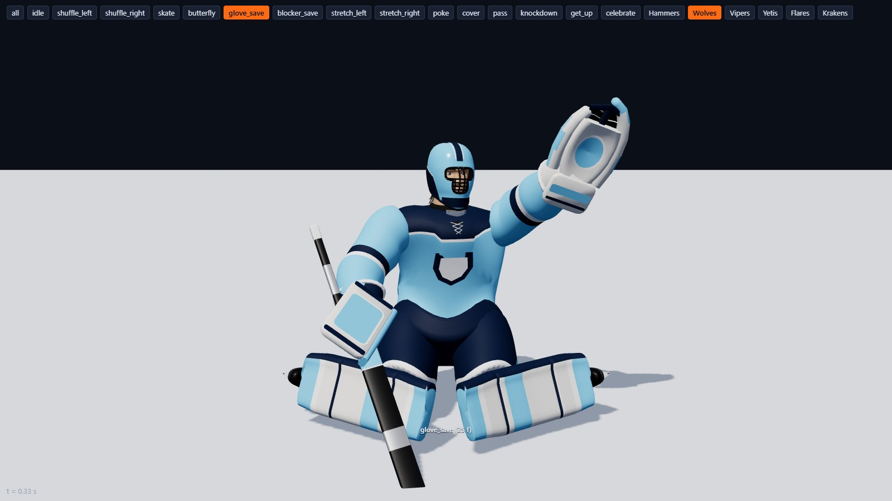
  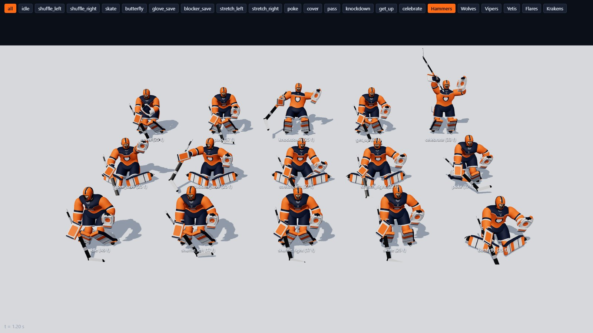
   The new goalie model: a glove save in Wolves colours, and all 15 clips side by side (/goalies-test.html).

- **New animated goalie model** (`public/models/goalie.glb` + `goalie.physics.json`)
  - Built in the Múcaro 3D app by a build script, on the same rig and format as `skater.glb`: 19 body bones and team-colour material slots.
  - Gear: a mask with a cage and painted decals, big leg pads, a blocker on the stick hand, a catching glove on the left and a goalie stick.
  - Spring-physics hair, like the skaters.
  - Each goalie gets his own clone in team colours, with a random skin tone and hair colour and a back number (0.24 m, a little bigger than a skater's). He is mirrored in the ice reflection, which is dropped on Low quality.
- **15 clips**, driven by the goalie sim (`public/render/goalie-models.js`):
  - Stance and movement:
    - `idle` is his ready stance;
    - `shuffle_left` and `shuffle_right` play across the crease, with playback speed following his sideways speed;
    - `skate` plays when he leaves the crease.
  - Saves are picked from where the puck met him:
    - high shots get `glove_save` or `blocker_save`, and a caught puck always goes to the glove;
    - low shots out wide get `stretch_left` or `stretch_right`;
    - everything else gets `butterfly`.
  - Puck handling: `cover` plays while he holds a caught puck, and the game's puck is hidden while it is in his glove. `pass` is his outlet pass and `poke` his poke check.
  - Falls: `knockdown`, then `get_up`.
  - `celebrate`.
- If the model can't load, the procedural goalies are drawn as before. Skaters and goalies fall back independently.
- Save, pass and steal events now feed the goalie animations as well as the skaters'.

### Camera & replays

#### Play camera

  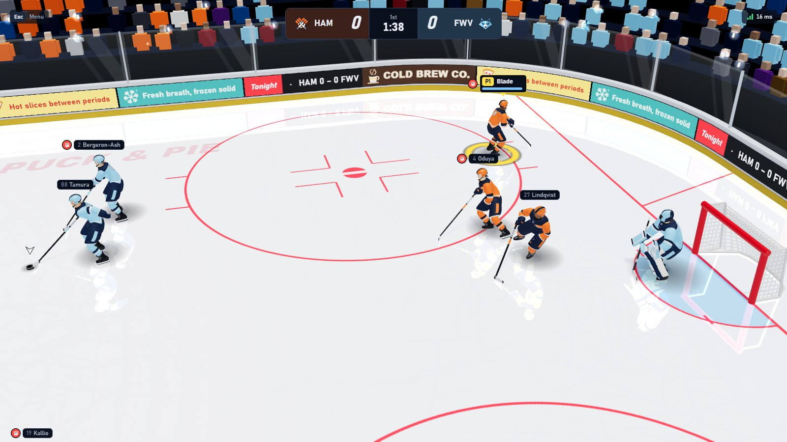
   The camera follows your skater (P1, yellow ring and plate). The white chevron marks the puck; the animated goalie is in the net and the LED boards run ads.

- **Classic arcade side view.** It sits lower and closer, with a longer lens: 32 deg FOV, 10 m up and 18.2 m back. It was 40 deg, 15 m and 21.8 m.
  - About one zone fills the frame and the skaters are much bigger on screen. The far boards sit near the top with a strip of crowd.
  - At least 50 deg of horizontal view is always kept, so 4:3 screens widen.
  - Orbits and the intermission shot keep the old wide lens.
- **It follows the skater you control**, and switches when you switch players.
  - Spectators, attract mode and replays still follow the puck.
  - It tracks across the ice more closely than before.
- **Puck indicator** (`render/puck-marker.js`): a white chevron with a dark outline floats over the puck. When the puck is off screen, an arrow pinned to the edge points at it.
  - Shown during live play and faceoffs whenever the camera follows your skater.
  - Hidden while you carry the puck, during fights and during replays.
- **Portrait screens** get a higher, steeper and wider view, so the rink's width fills a tall screen. The hanging scoreboard is hidden while the camera looks down through it.
- The field of view now eases smoothly between shots. The goal and fight push-ins were retuned for the new framing.
- The glass stanchions on the camera side of the rink are no longer drawn, so they don't cut across the bottom of the frame.

#### Goal replays

  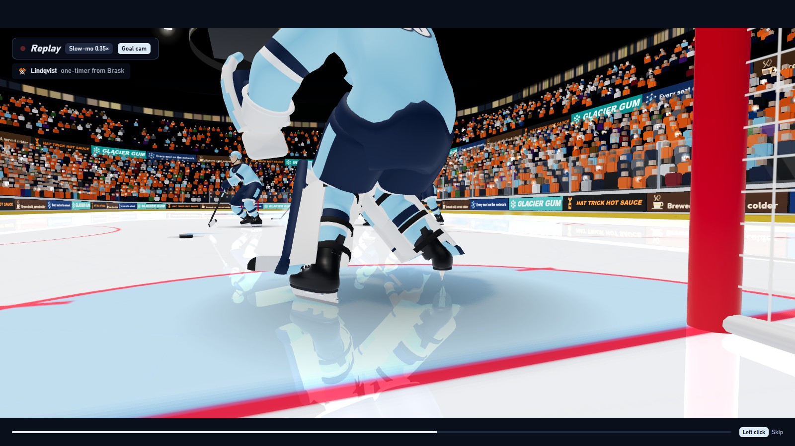
  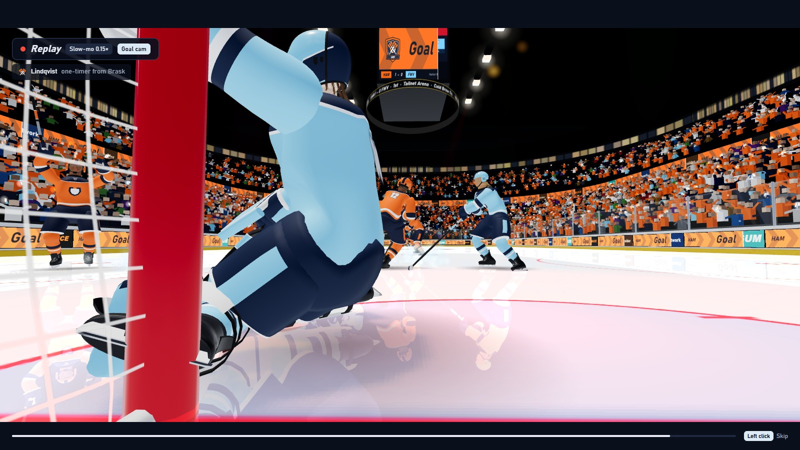
   Goal cam from inside the net: 0.35x as the one-timer comes past the goalie, then the 0.15x finish as he dives too late and the arena lights up.

- **Longer and slower** (`public/replay.js`, `extras.js` `planReplay`):
  - The replay starts 0.8 s after the goal and always ends before the faceoff drops the puck.
  - It plays a **6 s run-up** at full speed (was 3.5 s at 0.9x).
  - **Slow motion at 0.35x** starts from the windup, 0.55 to 1.0 s before the goal depending on the shot.
  - An **extra-slow 0.15x finish** runs from 0.25 s before the puck crosses the line until it is in the twine (0.3 s after).
  - The replay buffer is now **10 s** (was 5 s).
- **Goal cam** (the default slow-mo camera):
  - It sits inside the net, low at the back, behind the goalie, and is offset toward the side the puck went in. The shot comes at the lens past the goalie, not through him.
  - It looks up the puck's path at the shooter, then widens from 44 deg to 66 deg as the puck flies into the net.
- **Puck cam** (new option, **Settings > Video > "Puck cam on goal replays"**, default off):
  - The slow-mo rides 1.4 m behind the puck with a wide lens.
  - It freezes once the puck is in the net, so the rebound doesn't spin it around.
  - Players right at the lens are not drawn, so the screen never fills with the inside of a jersey.
- **Broadcast-style hard cuts** between the run-up and the slow-mo camera, instead of the camera swinging across the rink.
- **A glass break just before a goal is part of its replay.** The broadcast camera pans to the broken panel, holds on it, then returns to the puck. The run-up plays faster (up to 1.8x) when needed to fit it in.
- **New replay overlay:**
  - Letterbox bars and a "Replay" bug with a blinking red dot.
  - A **"Slow-mo 0.35x" chip** that follows the actual rate and changes to 0.15x for the finish.
  - The tail camera's name ("Goal cam" or "Puck cam").
  - **A scorer caption** with the team crest: "assist Mags", "unassisted" or "one-timer from Mags". Human players' names win over roster names.
  - A progress line with a **Skip glyph for your input device**: the A button on a pad, your bound shoot key on keyboard and mouse (for example "Left click"), or "Tap" on touch.
  - Shoot, pass or deke skips the replay. Turbo doesn't, because touch auto-turbo can hold it.
- While a replay plays, nothing else is drawn over it: the scoreboard, callouts, hints, head plates, in-game chat and touch turbo bar are all hidden.

#### Glass-smash picture-in-picture (new, `public/glass-pip.js`)

  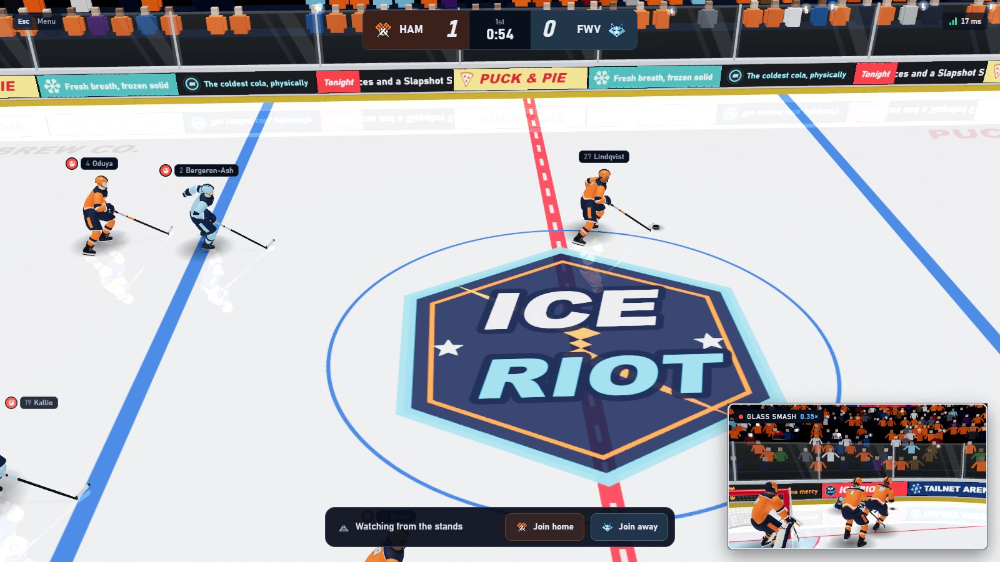
   Live play continues while the smash replays bottom-right at 0.35x.

- About 1 s after glass shatters in live play, a small corner screen labelled **"Glass smash"** replays it:
  - first the run-up at full speed;
  - then about 1.2 s of slow motion at 0.35x (with a "0.35x" tag) through the smash.
- It is shot from the ice a few metres off the broken pane, at a three-quarter angle, pushing in slowly with the crowd behind.
- Size and position:
  - about 26% of the screen width (200-420 px), 16:9;
  - bottom-right on desktop, top-right on touch screens, where the touch controls own the bottom.
- A newer smash replaces the one waiting to play, and a goal replay closes it.
- It costs nothing until needed:
  - the inset scene is built and its shaders compiled during a faceoff, when play is frozen;
  - it renders at Low quality and draws nothing unless a smash is replaying.

### Visuals & arena

#### Puck
- **A smaller, more realistic puck.** It is drawn at about twice the size of a real puck: radius 0.65x and height 0.7x of the arcade collision size. It used to be drawn at 1.5x.
- It now sits just in front of the stick blade, along the carrier's facing, instead of through it. Its bright rim is thinner.

#### LED ad network (new, `render/ads.js`)
- **Digital dasher boards.** The boards now carry a band of LED screens (0.27-0.92 m up, 8 screens per board period) in place of the printed ad panels.
  - The fascia ribbon between the bowls runs the same ads, tiled to its real length so the corners don't stretch.
- **8 fictional sponsors with animated art and taglines:**

  | Sponsor | Tagline |
  |---|---|
  | Ice Riot | "Three on three, all glass" |
  | Cold Brew Co. | "Brewed cold, served colder" (steaming cup) |
  | Puck & Pie | "Hot slices between periods" (dripping slice) |
  | Tailnet Arena | "Every seat on the network" |
  | Glacier Gum | "Fresh breath, frozen solid" (spinning snowflake) |
  | Slapshot Soda | "Crack one open" |
  | Zero Kelvin Cola | "The coldest cola, physically" |
  | Hat Trick Hot Sauce | "Three peppers, no mercy" |

- **Four channels**, each running its own playlist. An ad changes every 8 s with a wipe, slide or drop, and a match ticker follows every fourth ad.
- **Goal takeover:** every LED surface switches to the scoring team's colours at once, in sync, for about 4.6 s.
- **The jumbotron is now an LED screen:**
  - the score during play;
  - **animated ad breaks during stoppages** (faceoff waits, "End of 1st/2nd/3rd" and "End of overtime"), with a score strip;
  - a goal screen in the scorer's colours.
  - Its copy is now sentence case in the UI font: "Tailnet Arena", "Warming up the ice", "Goal", "Final".
- **The ring under the jumbotron is a live ticker.** It shows "City Name vs City Name · KEY 2 - 1 KEY" and crawls in whole-LED steps like a real LED strip.
- An LED pixel grid and a faint refresh band are drawn by the surface shaders.
  - The LED canvases redraw at up to 15 fps, or 8 fps on Low quality.
  - **Reduce flashes** turns off the pulsing takeovers and the refresh band.

#### Crowd
- **Fans hold up their phones** (new, `render/crowd-phones.js`):
  - About 7% of the crowd normally, rising to about 18.5% for goals, fights and big hype, then easing back down.
  - The holder's right arm rises with the phone, at chest to face height, swaying gently.
  - Screens glow cool white, warm white or the fan's team colour.
  - A few phones fire a camera flash at big moments (never with Reduce flashes). These replace the crowd's old random camera flashes.
  - The phones cost one extra draw call.

#### Head indicators (new, `render/head-tags.js`; replaces the bottom-left "You" panel and the old sprite name tags)
- **Your plate** floats over your helmet (and over each couch co-op player's):
  - a slot badge (P1-P4 in yellow, cyan, pink and green) and your name;
  - a turbo bar;
  - a slap-charge bar while you charge, reading "Max" when it's full;
  - an "On fire" status with a flame;
  - a caret in your slot colour pointing down at your skater.
- **Remote humans** get a name tag with a thin border in their team colour.
- **AI skaters** get a number and a name. Goalies get none.
- **Tough guys** (checking 6 or more, the only skaters who can start a fight) get a red fist roundel beside the plate or tag.
- Plates stay the same size at any distance, sit on whole pixels for crisp text and never lag their skater.
  - They scale with the window height (0.85x-1.5x) and stay inside the screen edges.
  - They fade in and out, and respect reduced motion.
- **Settings > Video > "Name tags over players"** hides the remote and AI tags. Your own plate always shows.
- All plates hide during instant replays, fights and the final screen.
- The floor ring under human skaters stays, in the same slot colours. The old spinning cone arrows over local players are gone.

### UI redesign

  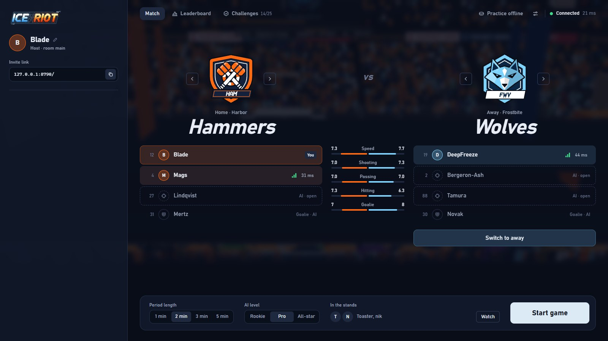
  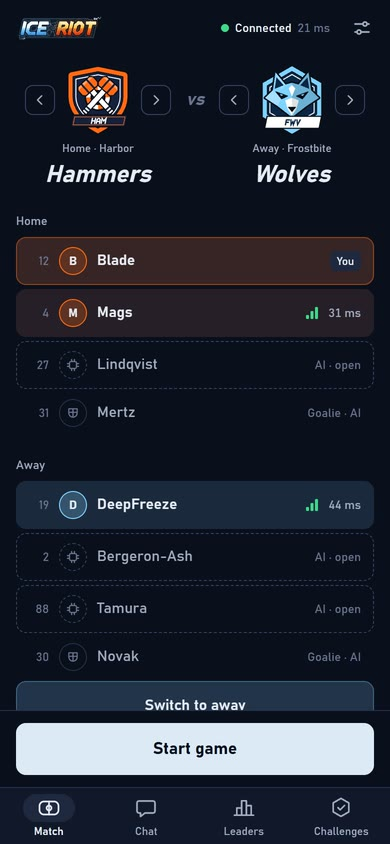
   The redesigned lobby (desktop) and the new portrait-phone lobby.

The whole app shell was redesigned on a canvas in Coqui, then ported:
- shared design tokens;
- the Bahnschrift UI face (it ships with Windows, so nothing is fetched and the game still works offline on a tailnet);
- sentence-case copy throughout (no more all caps);
- inline SVG icons.

#### Lobby
- **Left rail:**
  - the ICE RIOT wordmark;
  - your avatar, tinted in your team colour;
  - your name, editable in place (pencil button, a "Saved" confirmation, 16 characters);
  - a role line such as "Host · room main", "Watching from the stands" or "Offline practice";
  - the invite link;
  - lobby chat.
- **Invite popover:** "Invite friends" with a **Copy link** button. On localhost it warns "Localhost only works on this PC" and tells you to send the Tailscale address the server printed instead.
- **Top bar:**
  - view tabs: **Match**, **Leaderboard** and **Challenges** (with a done/total count);
  - **Practice offline** (or **Go online**) and **Settings**;
  - a connection status: "Connected" with the ping, "Reconnecting · retry in N s", "Joining" or "Offline practice".
- **Match view:**
  - Two team sides with big crests.
  - The host gets previous/next arrows, and clicking a crest opens a **team picker** grid:
    - arrow keys browse;
    - the team playing the other side is disabled.
  - Lineup rows:
    - humans show ping signal bars and ms, and a "You" chip;
    - open AI slots read "AI · open";
    - goalies read "Goalie · AI".
  - Join and switch buttons: "Join home", "Switch to away" or "Home is full".
- **Player career card:** hover a human in a lineup to see their record (W-L), goals, hits, glass and a win-percentage bar. It reads "No games on record yet" for new players. The data comes from the existing `/api/player` endpoint and is cached for 30 s.
- **Head-to-head ratings:**
  - five rows (Speed, Shooting, Passing, Hitting, Goalie) with mirrored bars;
  - a one-line summary such as "Wolves ahead in 3 of 5" or "Evenly matched".
- **Match bar:**
  - **Period length** (1 / 2 / 3 / 5 min) and **AI level** (Rookie / Pro / All-star);
  - **In the stands**, with avatars and a **Watch** button;
  - **Start game**.
  - Guests see the host's choices and "Waiting for <host>".
- **Toasts** were redesigned with icons:
  - "<name> joined home", "<name> moved to away", "<name> left", "You are now the host", "Invite link copied", "Connection lost, reconnecting" and "Reconnected";
  - warnings and errors stay above routine toasts, and at most 4 show at once.
- **Gamepad in the lobby:**
  - the D-pad walks the buttons, A presses and B lets go;
  - from the stands, A with nothing focused joins the first open side;
  - A never switches a player who is already on a team.

#### Portrait-phone lobby (new)
- One column with a **bottom tab bar**: Match, Chat (with an unread count), Leaders and Challenges.
- A sticky **Start game** / "Waiting for <host>" band.
- The team picker opens as a full-screen sheet.
- Guests see the host's settings as dimmed controls marked "Set by the host".
- **Keyboard-aware chat:**
  - the lobby follows the visible viewport, so the composer rides on the keyboard;
  - the tab bar hides while you type, and **Done** dismisses the keyboard.
- The Chat tab title reads like "Room main · 6 here".
- Coming back from a game always lands on the Match tab.

#### In-game HUD

  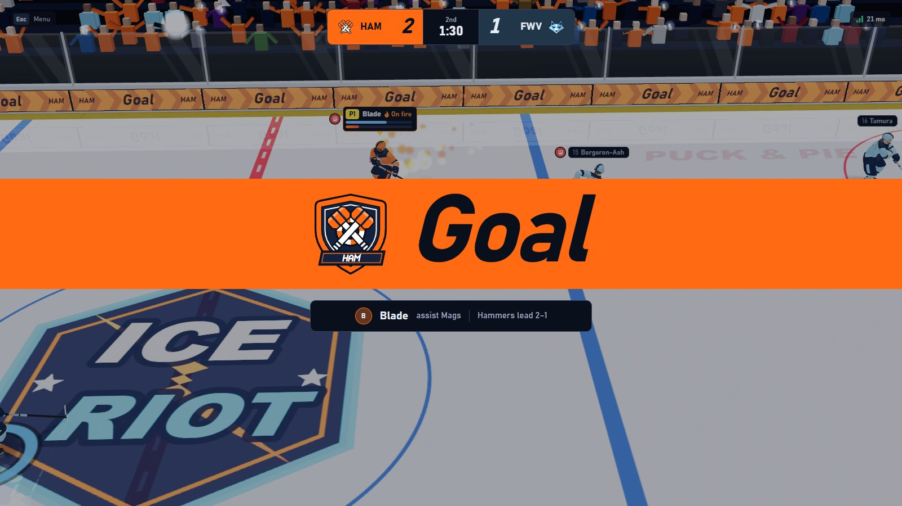
   Scoreboard, head plates and the opaque team-colour goal band with the scorer line.

- **Scoreboard:**
  - team crests and keys;
  - scores bump when they change, and the scoring side lights up for 3.2 s;
  - a period label (1st / 2nd / 3rd / OT / Intermission / Final);
  - the clock shows tenths under 10 s with a low-time style, and has an overtime style.
- An **"Esc Menu"** hint, a **Menu** button and a ping readout with signal bars.
- **Spectator bar:** "Watching from the stands", with team-tinted **Join home** / **Join away** buttons.
- **Faceoff plate** with a progress bar.
- **Callouts** on dark plates:
  - **Big hit**: "Blade flattened DeepFreeze";
  - **Glass!**: "Blade put DeepFreeze through the glass";
  - **On fire**: "shoots and hits harder";
  - **Overtime**: "Sudden death · next goal wins";
  - **Period N**, with both crests;
  - **End of 1st**, with the score and shots and hits.
  - Quick pills: **Save**, **Post** ("Ding"), **One-timer** and **Go**.
  - Names show in team colours. More important callouts take priority over smaller ones.
- **Goal callout:**
  - an **opaque team-colour GOAL band** with the crest ("Goal" or "One-timer goal");
  - a detail line with the scorer's avatar and name, the assist and the game state ("Tied 2-2" or "Wolves lead 3-2").
- **Phone held upright in game:** a phone 600 px wide or less shows "Turn your phone sideways to play" with a Menu button, and your input pauses until you turn it. Tablets still play upright.
- **2D fallback:**
  - The banner now reads "3D isn't available on this device, so you're on the simple 2D view. Everything still works." It dismisses itself after 8 s in game, or with **Got it**.
  - The 2D view now draws your own slap-charge arc and turbo bar.
- **Fatal screen:** "The game couldn't start", with a **Reload** button and "Check the server is running, then reload".

#### Pause menu

  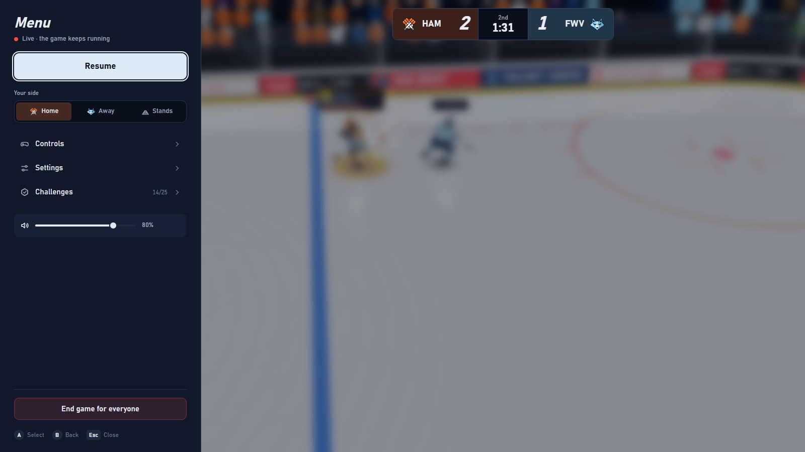

- "Menu · Live · the game keeps running" and **Resume**.
- **Your side**: Home / Away / Stands.
- Rows for **Controls**, **Settings** and **Challenges** (with the count).
- A volume slider with mute, and **End game for everyone** for the host.
- Pad hints: A Select · B Back · Esc Close.
- **Gamepad:** Start toggles the menu, the D-pad moves, left and right change the volume by 5, and B closes.

#### Final screen

  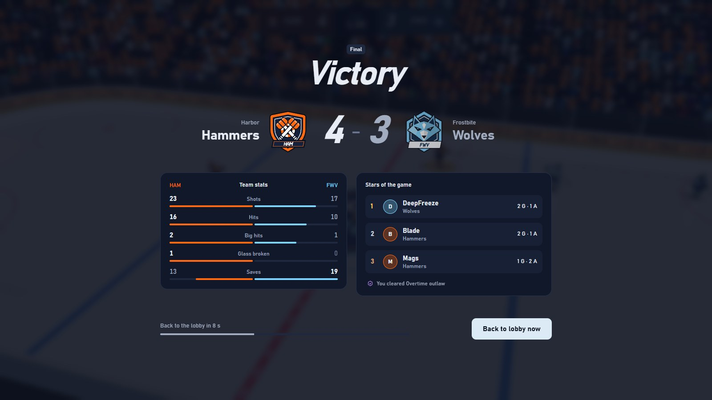

- A "Final" or "Final · OT" chip, and a **"Victory"** title when your team wins.
- The big score with crests, with the losing side dimmed.
- A **Team stats** card with mirrored bars: Shots, Hits, Big hits, Glass broken and Saves.
- **Stars of the game:** the top 3 by goals, then assists, then hits, with an "OT winner" tag.
- Challenges cleared this game: "You cleared Lamp lighter and 2 more", or "Secret challenge cleared: ...".
- "Back to the lobby in N s" (12 s) with a progress bar, and **Back to lobby now** for the host.

#### Settings sheet
- Settings now opens as a **600 px right-hand sheet** that slides in over a dimmed backdrop. It replaces the centred dialog.
  - The header has an Esc chip and a close button; clicking the backdrop also closes it.
  - Tabs: **Audio / Video / Controls / Gameplay**.
- **Audio:**
  - a new **Announcer** volume slider (default 90%);
  - **Mute all** ("M toggles it anywhere"), and M also works inside the sheet;
  - the volume rows dim while muted.
- **Video:**
  - the new **Puck cam on goal replays** toggle;
  - **Name tags over players** (renamed from "Show player names");
  - Quality Auto / High / Medium / Low ("Auto adapts to your device").
- **Gameplay:**
  - **Tutorial hints** ("Tips for shooting, passing and checking");
  - **Player name** with an n/16 counter. It applies about 0.6 s after you stop typing, updates the lobby rail and is remembered.
- **Reset all** asks you to confirm: "Confirm reset · Your name is kept". The per-tab "Reset controls" button is gone.
- Pressing **B** on a gamepad closes any open sheet (Settings, Challenges or Leaderboard).

### Controls & input

- **Mouse buttons:**
  - Shoot is now **Left click** + Space (was J + Space).
  - Pass is now **Right click** + K (was K).
  - Deke (L), Turbo (Shift) and skating (WASD or arrows) are unchanged.
- Existing settings migrate from v1 to v2: shoot and pass bindings still on the old defaults move to the mouse defaults, and custom bindings are kept, each action on its own.
- Left, middle and right click can be bound to any action. Back and forward buttons can't.
- Mouse buttons only act on the game surface, never on a button, field, menu, sheet or the chat.
  - Right click never opens the browser menu during a game; text fields keep it for paste.
  - Middle-click autoscroll is blocked.
- **Controls tab:**
  - "Keyboard and mouse" with Primary and Alternate columns, and a single "Skate" row for the four directions.
  - Hints per action:
    - "Tap wrister, hold slapshot, no puck checks";
    - "No puck switches skater";
    - "No puck stick-checks";
    - "Hold to sprint, add shoot for a big hit".
  - Mouse glyphs show "Left click", "Right click" or "Middle click".
  - Unbound actions show "Not bound".
- **Rebinding:**
  - click a slot, then press a key or click a mouse button;
  - Esc cancels, and Backspace or Delete clears the slot;
  - keys already in use swap, with sentence-case status messages;
  - a rebound slot flashes green.
- **Gamepad reference list:** labels updated, plus a new row: Start = "Menu, or join on a spare pad". The pad mapping is unchanged.
- **Esc** no longer toggles the pause menu while a sheet is open. The sheet closes itself first.
- The global **M** mute keeps the settings toggle in sync.

### Fights

  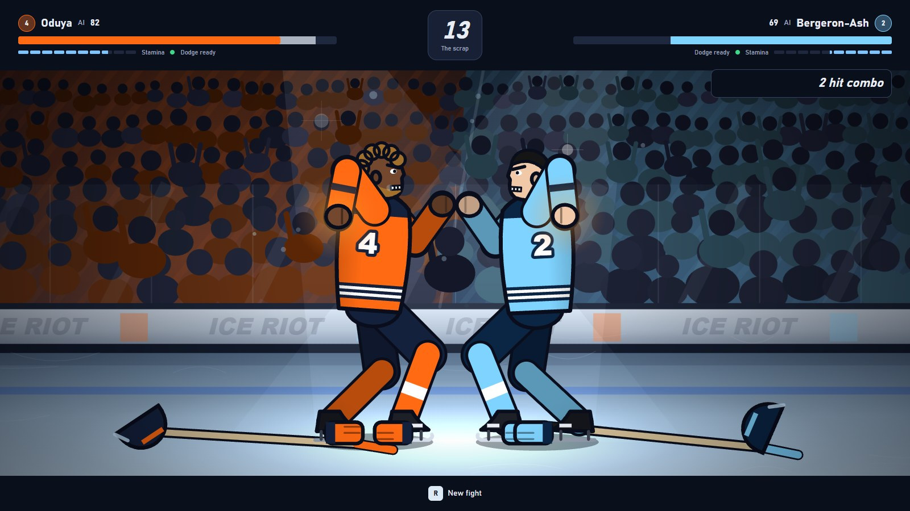
   The scrap: HP, stamina and dodge meters, the 15 s clock and combo chips.

- Fights last **up to 15 s** (was 8 s).
- **Redesigned overlay:** the scene is still drawn on canvas, but everything on top is now sharp DOM, matching the new look.
  - **Top band**, for each fighter:
    - a number avatar and the roster name;
    - who controls them: the player's name, "You" or "AI";
    - HP, which turns red below 30, with a damage trail;
    - 10 stamina pips ("Stamina low" under 25%);
    - dodge status ("Dodge ready" or "Dodge recharging").
  - **Clock tile**, "The scrap": it counts down from 15 and turns red at 3 s.
  - **Combo** ("N hit combo") and **"Counter ready"** chips.
  - **Callout plates**: "Tempers boil over", then "Gloves off!" (with "Name vs Name"), then "Brawl!", and finally "Lights out!" or "Time!".
  - Pop-ups over the fighters: "Counter!", "Haymaker!", "Interrupted!", "Blocked", "Guard break!", "Whiff!" and "Tie-up!".
  - **Winner banner** in the team colour with the crest: "<Name> wins the scrap · Full turbo + on fire".
  - **The hint band uses your real bindings**, for example "Left click jab · L haymaker · Right click block · L-Shift dodge", with mouse glyphs. There is no band for spectators or touch players.
- **Camera shake** and **Reduce flashes** now apply to fights. Reduced motion turns the fight shake off.
- The pause menu and the "turn your phone sideways" prompt now cover the fight overlay.
- **Touch:** during a fight the buttons read Jab / Block / Haymaker / Dodge.

### Challenges & leaderboard

#### Challenges
- **5 new secret challenges** (kept out of the 25 total):

  | Challenge | Tier | How to clear it |
  |---|---|---|
  | **Heavyweight** | 2 | Win a fight. |
  | **Bar down** | 2 | Ring the post 3 times in one game, off your own shots. Each post must come within 2 s of the shot, with no touch in between, and one shot rings at most one post. |
  | **Night shift** | 1 | Finish a game you played between midnight and 5 am local time. |
  | **Glass and gas** | 3 | Score within 10 s of shattering the glass yourself. |
  | **Spectator sport** | 1 | Watch a whole game from the stands, from the opening (first 20 s of the 1st, 0-0) to the final horn, and at least 60 s of play. |

  A locked secret shows only "Secret · ??? · Keep playing". Once cleared it reveals its title and description.
- The 25 main challenges are unchanged in goals.
  - Their copy is now sentence case, for example "Lamp lighter" and "Glazier's nightmare".
  - New tier colours: Tier I blue-grey, Tier II violet, Tier III amber.
- **Challenges view in the lobby:**
  - "N of 25 cleared" over a tier-split meter;
  - filters: All / Tier I / II / III / Secrets / Open;
  - cards grouped by tier, each showing a "New" chip, "Cleared 12 min ago" or a date, a progress bar ("Best 2/3" for in-one-game challenges), or "In one game" / "Career".
- **In-game Challenges sheet** (from the pause menu): a right-hand sheet that pauses your input while open.
- **Unlock toasts** redesigned with a tier tile: "Challenge cleared" or "Secret challenge cleared". They are faster, and at most 3 show at once.
- Cleared challenges also show on the final screen. Old saves keep every unlock and counter.

#### Leaderboard
- **Now a lobby view** instead of a full-screen sheet. Offline, it says "The leaderboard lives on the server. Go online to see it".
- **Rank by** Wins / Goals / Hits / Glass, with columns #, Player, GP, Wins, G, A, Hits and Glass.
  - The ranked stat is highlighted with a bar, and zeros are dimmed.
  - The top 3 get gold, silver and bronze chips.
- **Your row** is highlighted with a "You" chip and tinted in your team's colour.
- **Recent games:**
  - both crests and the score, with the winner in bold;
  - an OT chip;
  - the top performers ("Blade 2G 1A · DeepFreeze 2G");
  - a compact age (now / 12m / 2h / 1d).
- **It survives a lost connection:**
  - "Updated HH:MM" with a refresh button;
  - if a refresh fails, the last data stays up with "Offline, updated HH:MM";
  - clearer errors: "Could not reach the server" or "Request timed out";
  - skeleton rows while loading, and friendly empty states ("No stats yet").
- **Responsive layout** down to phones: the phone Leaders tab shows 52 px rows with a summary line and only the ranked stat.

### Chat, tutorial, touch, couch & offline

- **Chat:**
  - Lobby chat lives in the rail, with "T to type".
    - Each line shows the name in its team colour (spectators in grey), the time and the text.
    - The empty state reads "No messages yet. Say hi.".
  - The 8 quick lines are the same: Nice!, Pass it!, Shoot!, My bad, What a hit!, GG, Rematch? and On fire!. They are now chips with a 2 s cooldown.
  - **In game:**
    - a fading feed bottom-left (lines stay 8 s, at most 6 shown);
    - T or Enter opens a panel with numbered quick lines ("Enter sends · Esc closes"), and keys 1-8 send them;
    - the "Chat · 1-8 quick" button now shows on touch screens only;
    - clicking the chat no longer fires a left-click shot.
  - **Phone Chat tab:** a scrolling chip strip, an n/120 counter and a send button that keeps the keyboard up.
- **Tutorial hints:**
  - The same hints with new sentence-case copy:
    - "Puck's yours: Tap to wrist / Hold to slap";
    - "Stop the carrier: Check / Big hit / Poke";
    - "Sudden death: Overtime · next goal wins";
    - and so on.
  - An urgent red **"Shoot now"** card for one-timers.
  - Fire and overtime cards are tinted.
  - Key glyphs follow your bindings: mouse glyphs for clicks, and readable names like L-Shift, Space and Num 5.
  - Pad glyphs were restyled, and touch hints show copies of the on-screen buttons.
  - Placement:
    - bottom-centre;
    - top-centre on touch;
    - a compact top-right card on a sideways phone.
- **Touch controls:**
  - Redesigned round, dark buttons, with an ice-coloured **Shoot** labelled "Shoot / hold to slap", or "Check / + turbo hits" without the puck.
  - Sized from the screen: the stick is about 18% of the short side, and Shoot about 30%.
  - The slap charge is a ring around Shoot, solid red at max.
  - A plain stick ring that turns turbo-blue.
  - Fight labels.
  - A new **turbo bar** (top-left, sideways phones only), which turns red below 25%.
  - Phones and tablets now start in touch mode for glyphs and hints.
- **Couch co-op:** each couch player gets their own head plate in their slot colour (P2-P4). Error messages were reworded.
- **Offline practice:**
  - The button toggles between "Practice offline" and "Go online".
  - Toasts were reworded: "Can't reach the server, so you're in offline practice against the AI" and "Offline practice against the AI. You're the host".
  - "The server is reachable again" shows only once per offline session.
  - Career cards aren't fetched while offline.

### Developer notes

#### New modules and assets
- `public/render/goalie-models.js`: the animated goalie models (`createGoalieModels`).
  - Methods: `load`, `tick`, `update`, `hide`, `hideAll`, `cull`, `setTeams`, `onEvent`, `setReflections`, `covering(id)` and `dispose`.
- `public/models/goalie.glb` (about 4.3 MB) and `public/models/goalie.physics.json`: the goalie rig, its 15 clips and the hair-physics data.
- `public/render/head-tags.js`: screen-space head indicators.
  - API: `TAG` kinds, `SLOT_COLORS`, `entries[id]`, `update(dt, hidden)`, `render(renderer, camera)` and `stats`.
  - Each plate is a canvas on a quad in its own orthographic pixel-unit scene. A canvas is redrawn only when what it shows changes, and nothing is allocated per frame.
- `public/render/puck-marker.js`: the puck chevron and edge arrow, with `update(dt, on, x, y, z, carried)` and `render(renderer, camera)`.
- `public/render/ads.js`: the shared LED ad network, one per scene via `getAdNetwork(scene)`.
  - Methods: `patchBoards`, `patchRibbon`, `patchScreen`, `setTeams`, `setJumbo`, `takeover`, `update`, `setQuality` and `setCalm`.
  - Constants: `ADS`. `textures.js` gained `SPONSORS[].key/accent/tagline`, `BOARD_LED`, `UI_FONT`, `periodLabel` and `drawJumboScreen`.
  - Removed: `makeNameTag`, `makeToughIcon` and `makeRibbonTexture`.
- `public/render/crowd-phones.js`: the instanced crowd phones, plus `CROWD_MOTION_GLSL`, which is now shared with the crowd shader in `arena.js`.
- `public/glass-pip.js`: the glass-smash picture-in-picture (`createGlassPip`): `record`, `frame`, `stop` and `dispose`.
- `public/ui-icons.js`: inline SVG glyphs (`ICON.*`, `signalSVG`, `pingQuality`), stroked with `currentColor`. No emoji and no icon fonts.

#### Renderer
- **Inset mode (picture-in-picture):**
  - `createRenderer(null, { shareWith: main.three.renderer })` builds a second, independent scene that draws into a corner of the main canvas through the same WebGL context.
  - `setInset({ x, y, w, h })` takes CSS px with a bottom-left origin.
  - `render()` draws scissored into that rect after the main frame, adds to its draw stats, and draws no head plates or puck marker.
  - `resize()` is a no-op: the aspect follows the inset.
  - `dispose()` leaves the shared context alone.
  - Insets default to Low quality with no dynamic resolution.
  - New `warm()` compiles the shaders ahead of time.
- **Replay context** `ctx.replay = { cam: 'cast'|'net'|'puck'|'glass', goal: {x,z}|null, glass: {x,z,w}|null }`:
  - the camera rig gained `net`, `puck` and `glass` replay modes;
  - entering, leaving or switching one is a hard cut;
  - shake is scaled per shot.
- **Camera follow:** `info.follow` makes the camera follow the skater `ctx.myId` controls. New `rig.overJumbo` getter.
- `players.js`:
  - `cullNear(x, z, r)`, `covering(id)`, `renderTags(renderer, camera)` and `tagStats()`;
  - `onEvent` now also handles `save` and `steal`.
- `skater-models.js` gained `cull(id)`, and `effects.js` exposes `puckRadius`.
- `arena.update` accepts `phase` and `fight`.

#### Client modules
- `replay.js`:
  - `start()` options: `finishSec`, `finishSpeed` (`FINISH_SPEED = 0.15`), `caption` and `tailLabel`;
  - the `createReplay({ nameOf })` option;
  - new methods `findEvent`, `findEventMs`, `setSkipHint` and `skipHint`;
  - the `goalCaption()` export;
  - `update()` now also returns `tail`, `goal` and `ms`.
- `extras.js`:
  - new hooks `afterRender`, `lobbyView`, `sheetOpen`, `syncMute`, `replaying` and `isOffline`;
  - `planReplay(budget)`;
  - `html.ir-replaying` is set while a replay plays.
- `ui.js`:
  - new handlers `view(name, el)` and `playerStats(name)`;
  - new methods `showView`, `showTab`, `setChallenges`, `setOffline`, `noteUnlock`, `noteChat` and `setName(n, { save })`;
  - new exports `teamRatings`, `ratingsSummary`, `starsOfGame` and `teamVars`.
- `settings.js` (v2):
  - `MOUSE_CODES`, `isMouseCode`;
  - the `open(tab)` argument;
  - `puckCam` and `announcerVolume` in the UI.
- `input.js`: `MOUSE_CODES`, `mouseCode`, `isGameSurface` and `dispose()`.
- `touch.js`:
  - `setTurbo(v)`;
  - `setContext({ hasPuck, fight })`;
  - `BUTTON_DEFS` use `pos` offsets.
- `achievements.js`:
  - `SECRETS`, `ALL_CHALLENGES`, `summarize()` and `clearedLabel()`;
  - `mountView`, `progress`, `onProgress`, `isPanelOpen`, and the `onOpen` / `onClose` options.
- `leaderboard.js`:
  - `mount(el)`, `isMounted`, the `meTeam` option;
  - `formatClock` and `playersSummary`.
- `fight-view.js`:
  - `show()` takes `ctrlA/B`, `teamA/B`, `shake` and `flashes`;
  - pure exports `FIGHT_COPY`, `parseHint`, `popFor`, `winsText`, `comboText` and `LOW_HP`.
- `tutorial.js`: `mouseButton()`, `hintKind()` and `TUTORIAL_CSS`.
- `chat.js`:
  - `FEED_MS`, `nameColor()` and `formatTime()`;
  - `--ir-chat-lift` replaces `--ir-chat-bottom`.

#### Shared sim
- `saveProb(..., tArr)` takes an optional time-to-arrival.
- Flights carry `saveG`, the goalie who will make an early-decided save.
- Players carry `beatT`, `beatZ` and `beatS`.
- `lateDive(g)` is exported and called from `scoreGoal`.

#### Docs
- `docs/CONTRACT.md` documents:
  - `ctx.replay`;
  - the camera following `ctx.myId`'s skater;
  - the puck indicator;
  - the head indicators (`ctx.couchIds`, `ctx.showNames`) in place of the old name tags and local markers.
- `README.md`:
  - adds animated goalies;
  - describes the new replay (goal cam, puck cam, a glass break worked in);
  - drops "goalies stay procedural".

#### Demo mode (`main.js`)
- `?demo=lobby|game|final|menu`, plus:
  - `&as=guest`, `&side=-1|0|1` and `&conn=reconnecting`;
  - `&ev=goal|hit|glass|fire|ot|save|post|onetimer|go|period|end` with `&evat=`;
  - `&ph=faceoff`, `&clk=` and `&per=`;
  - fake career cards.
- Default random names are now in sentence case ("Blade42").

#### Tests
- `test/sim.test.js`:
  - new **"no passing to your own goalie"** test;
  - new **"goals go past the goalie, not through him"** test: 12 seeds, at most 5% of goals within 0.45 m of his centre;
  - the GOAL and fight timing loops now use `PHASE_DURATION` and `FIGHT` instead of fixed tick counts.
- `test/replay.test.js`:
  - the slower finish stage (`finishSec` / `finishSpeed`);
  - the caption plate and `goalCaption`;
  - replay cameras and the tail chip;
  - an overlay CSS rule check.
- `test/achievements.test.js` (+354 lines):
  - each secret;
  - secrets kept out of the 25;
  - `onProgress`;
  - save migration;
  - `clearedLabel`;
  - a real-sim secret-detection run;
  - the exact post-count test now **searches up to 12 more seeds** for a game with 4 or more posts, instead of pinning one seed.
- `test/settings.test.js`:
  - mouse codes;
  - the v1 to v2 migration;
  - mouse swaps;
  - sentence-case labels.
- `test/fight.test.js`: hint parsing, pop-up words, copy rules and a full fake-DOM HUD run from intro to KO to the winner band.
- `test/tutorial.test.js`: mouse glyphs, card kinds and stylesheet rules.
- `test/chat.test.js`: about 12 fake-DOM client tests.

#### Dev pages
- New **`/goalies-test.html`**: every goalie clip looping side by side in team colours, with hair physics.
  - Drag to orbit, wheel to zoom.
  - URL options: `?clip=`, `&team=` and `&t=` (deterministic hold for screenshots).
- Reworked dev pages:
  - `achievements-test.html`, now the "Challenge lab", with secret scenarios and "Find every secret";
  - `fight-test.html`, which gained an AI level and more URL params;
  - `tutorial-test.html`, with a hint gallery and phone frames;
  - `settings-test.html`;
  - `touch-test.html`, with `?fight=1` and `?puck=1`;
  - `chat-test.html` and `couch-test.html`.
- The other test pages gained a blank favicon to stop the 404.

---

## v0.1.0 · 2026-11-21

The first playable release (commits `cca6e74`, 2026-11-20, and `6a5f8f2`, 2026-11-21).

- **ICE RIOT**: an original 3-on-3 arcade hockey game for the browser. Three skaters plus an AI goalie
  per side, three periods plus sudden-death overtime, no icing, offside or penalties.
- **Multiplayer over Tailscale**: one machine runs a zero-dependency Node server (HTTP + hand-rolled
  WebSocket + rooms + the authoritative 60 Hz simulation); friends on the same tailnet open a link.
  Private rooms with `?room=name`, optional HTTPS through `tailscale serve`.
- **Drop-in/drop-out**: empty slots are AI, friends can join mid-game.
- **Arcade hockey**: turbo, wrist shots, charged slapshots, one-timers, dekes, stick checks, turbo body
  checks that can **shatter the glass**, and "ON FIRE" streaks.
- **Fights**: a fight mini-game between tough guys (checking 6+); the winner catches fire.
- **Instant goal replay**, synthesized **arena music**, crowd and SFX.
- **Animated skater models** (`6a5f8f2`): rigged players with team colours, back numbers, varied skin and
  hair, a hockey "flow" with spring-physics hair, and clips for skating, sprinting, shots (wrist, slap,
  one-timer), passes, checks, pokes, dekes, falls, faceoffs and celebrations. Built in Múcaro; goalies
  stayed procedural until v0.2.0.
- Lobby chat and in-game quick chat, **couch co-op** with extra gamepads, **touch controls**, **offline
  practice** against the AI in the browser, **challenges**, **settings** with key rebinding, contextual
  **tutorial hints** and a persistent **leaderboard** (`data/stats.json`, `/api/leaderboard`).

  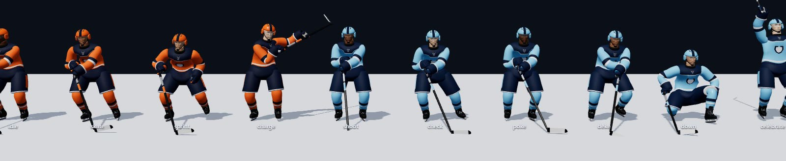
   The v0.1.0 skater model, every state's animation side by side (/skaters-test.html).

