<p align="center">
  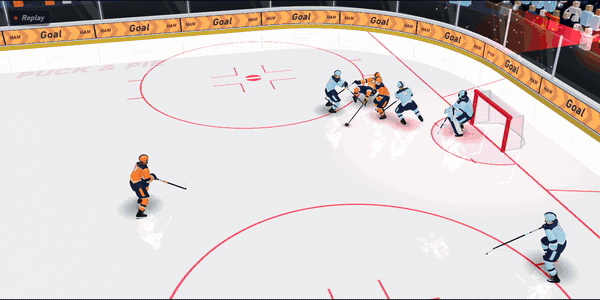
</p>

<h1 align="center">ICE RIOT</h1>

<p align="center">
  <b>Original 3-on-3 arcade hockey for the browser.</b><br>
  Bone-rattling hits, glass that shatters, ON FIRE streaks, fights and slow-motion goal replays,<br>
  played with friends over your own <a href="https://tailscale.com">Tailscale</a> tailnet.
</p>

<p align="center">
  
  
  
  
  
</p>

<p align="center">
  <a href="#quick-start">Quick start</a> ·
  <a href="#controls">Controls</a> ·
  <a href="#features">Features</a> ·
  <a href="#screenshots">Screenshots</a> ·
  <a href="CHANGELOG.md">Changelog</a> ·
  <a href="docs/HOSTING.md">Hosting guide</a>
</p>

---

Three skaters plus a goalie per side, three periods plus sudden-death overtime, and no icing, offside or
penalties. One machine runs a small Node server that runs the game and serves the web page. Friends on
the same tailnet open a link in their browser and play: no accounts, no installs for players and no
npm dependencies.

<p align="center">
  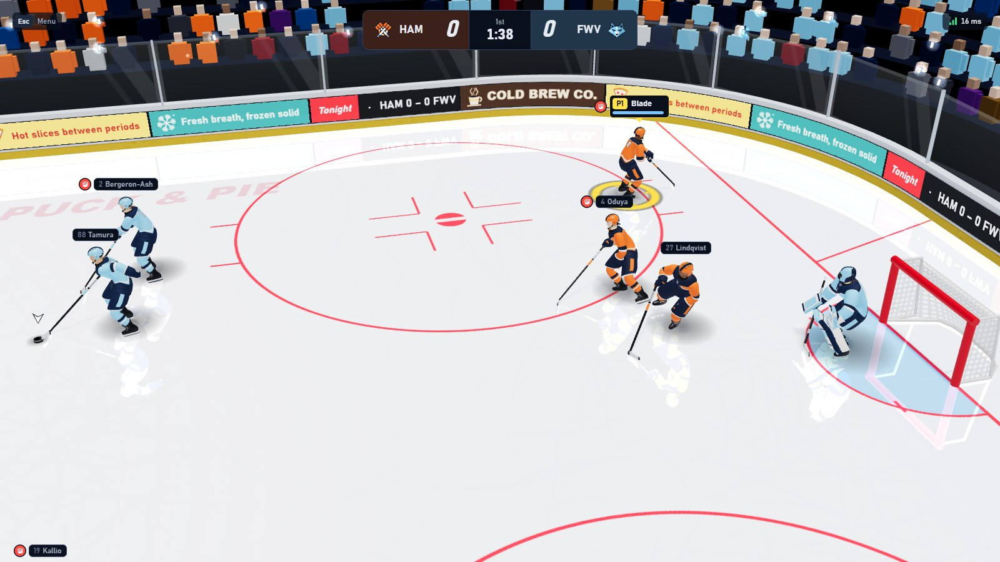
</p>

## What's new in v0.2.0

- **Animated goalies** with pads, mask, blocker and glove: 15 clips, saves picked from where the puck meets them.
- **Goals beat the goalie fair and square**: a goal goes past his body (or he bites on it), never through him.
- **A new arcade camera** that follows the skater you control, plus a **puck indicator** when it's away from you.
- **Goal cam replays from inside the net**: a 6 s run-up, 0.35x slow motion from the windup, then a 0.15x finish.
- **Glass smashes replay picture-in-picture** in a corner screen while play goes on.
- **A full UI redesign**, a **portrait-phone lobby**, **head indicators** over the players and **mouse controls**.
- **A living arena**: animated LED ad boards, an LED jumbotron and fans holding up their phones.
- **5 secret challenges**, longer fights, smaller puck, no passing back to your own goalie.

Everything, with screenshots: **[CHANGELOG.md](CHANGELOG.md)**.

## Screenshots

<table>
  <tr>
    <td width="50%">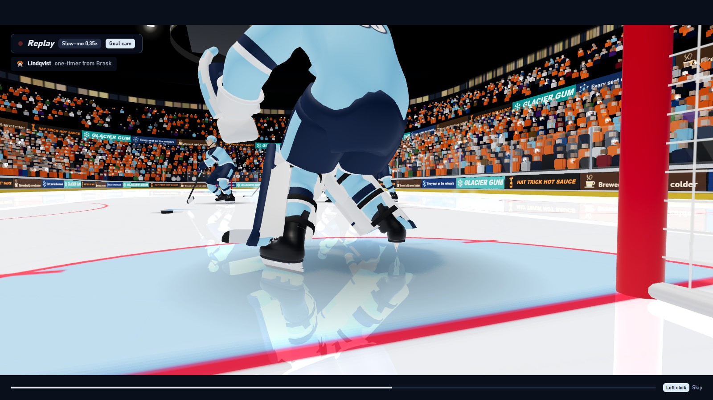<br><sub><b>Goal cam.</b> Slow motion from inside the net as the shot comes past the goalie.</sub></td>
    <td width="50%">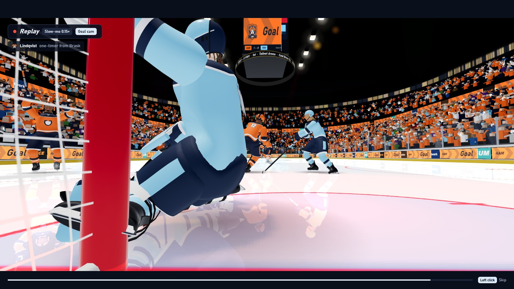<br><sub><b>The 0.15x finish.</b> He dives too late; the jumbotron and the LED boards go to the scorer's colours.</sub></td>
  </tr>
  <tr>
    <td>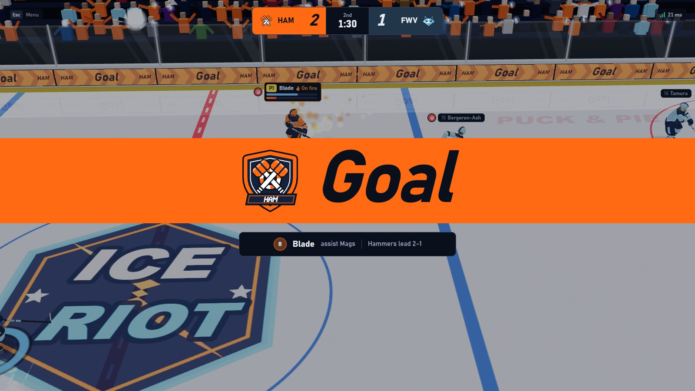<br><sub><b>Goal!</b> The team-colour goal band, scoreboard and head plates.</sub></td>
    <td>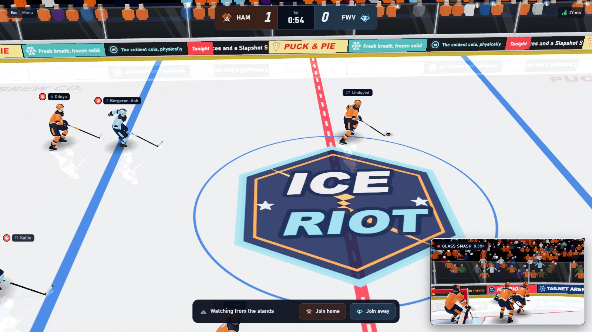<br><sub><b>Glass smash.</b> The smash replays in the corner while live play goes on.</sub></td>
  </tr>
  <tr>
    <td>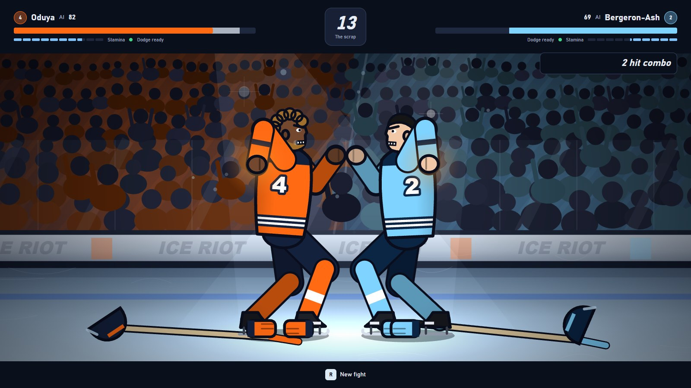<br><sub><b>The scrap.</b> Tough guys drop the gloves: jab, haymaker, block, dodge. The winner catches fire.</sub></td>
    <td>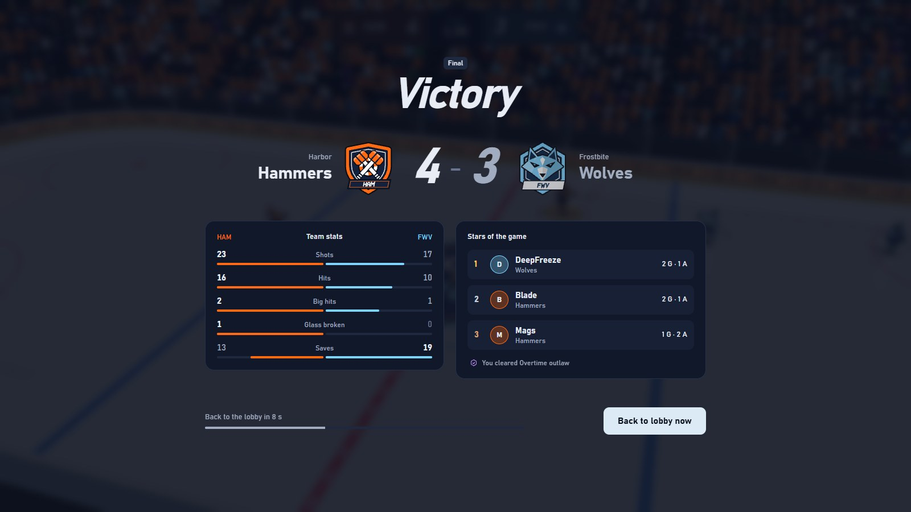<br><sub><b>Final.</b> Team stats, stars of the game and the challenges you cleared.</sub></td>
  </tr>
  <tr>
    <td>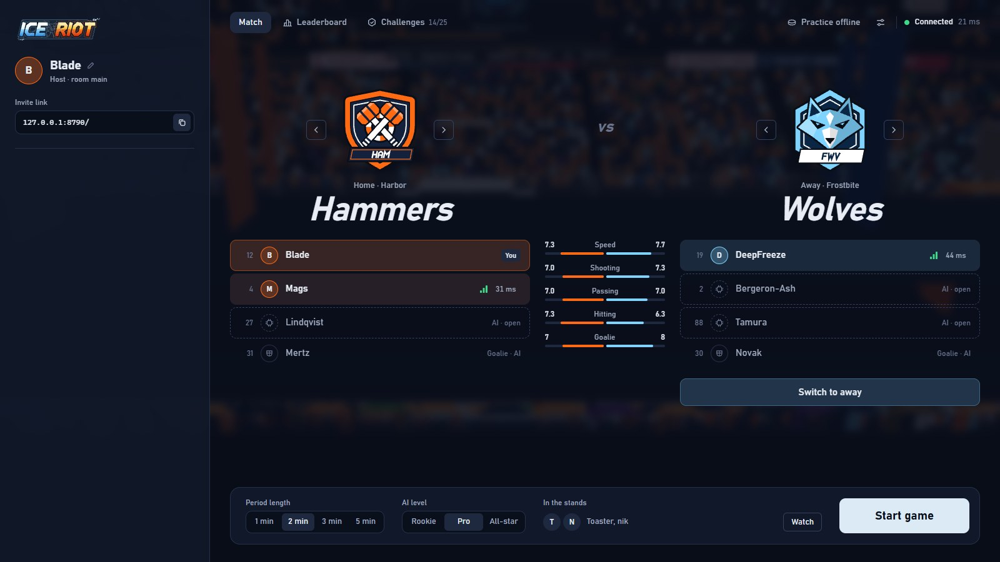<br><sub><b>Lobby.</b> Pick sides, period length and AI level; invite friends with one link.</sub></td>
    <td>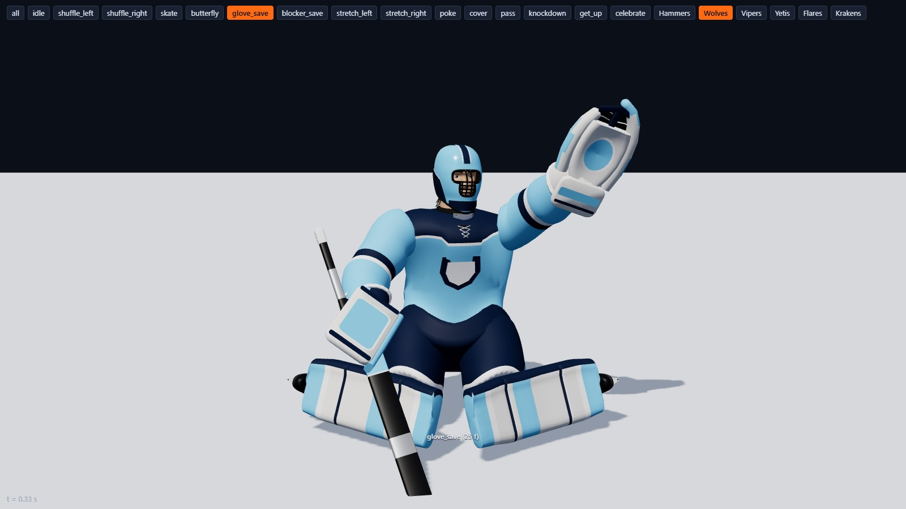<br><sub><b>Goalie model.</b> A glove save in Wolves colours (<code>/goalies-test.html</code>).</sub></td>
  </tr>
</table>

<p align="center">
  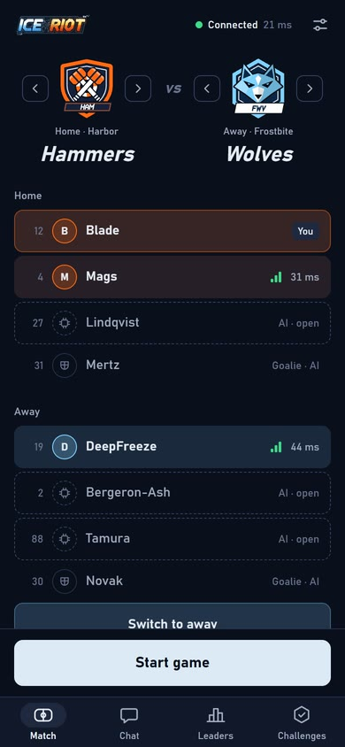
  &nbsp;
  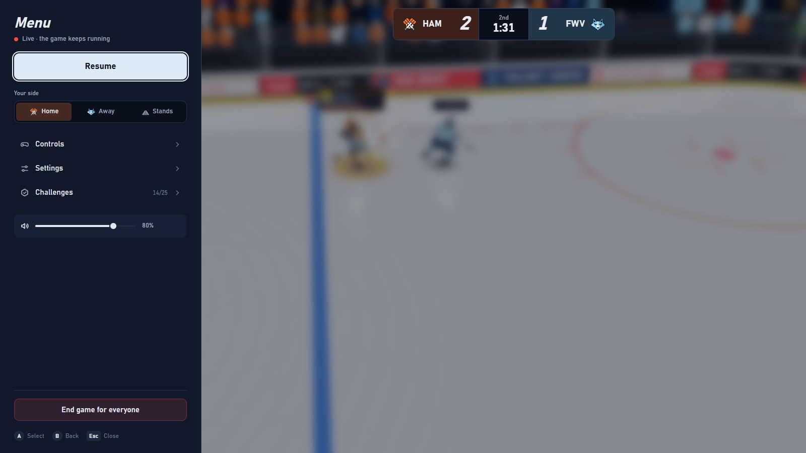
  <br><sub>The portrait-phone lobby and the pause menu (the game keeps running behind it).</sub>
</p>

## Requirements

- **Node.js 20 or newer**, on the host machine only.
- **Tailscale** on every player's device, all signed in to the **same tailnet**. Share the
  host machine with friends from the Tailscale admin console, or invite them to your tailnet.
- A modern browser (Chrome, Edge, Firefox, Safari). Keyboard and mouse, gamepad, or touch.

## Quick start

On the host:

```sh
npm start                 # or: node server/server.js   (Windows: .\start.ps1)
```

The server prints its URLs:

```
  Local:     http://localhost:8765/
  LAN:       http://192.168.1.20:8765/
  Tailscale: http://100.101.102.103:8765/
             http://my-pc.tail1234.ts.net:8765/
```

Open the Local URL yourself. Send friends the **Tailscale** URL (the 100.x address, or the
MagicDNS name). The first player to join is the host. The host picks the teams, period length
and AI level, then presses **Start game**. Empty skater slots are played by the AI. Players can drop
into a running game at any time by picking a side, or watch from the stands.

Options: `--port 9000` (or `PORT=9000`), `--host 127.0.0.1`, `--serve` (see below).
With npm: `npm start -- --port 9000`.

### Private rooms

Add `?room=name` to the URL (for example `http://100.101.102.103:8765/?room=friday`). Each room
is its own lobby and game. Rooms are created on demand and disappear when empty.

### HTTPS with `tailscale serve` (optional)

```sh
npm run serve             # = node server/server.js --serve
```

This binds the game to `127.0.0.1` and runs `tailscale serve --bg <port>`. Friends then use
**https://<your-machine>.<tailnet>.ts.net/**. Tailscale proxies to localhost, so no firewall
rule is needed. You need MagicDNS and HTTPS certificates enabled for your tailnet. The first time,
Tailscale may print a link to enable Serve; open it, approve, and the command finishes.
The server never touches your other serve settings: if `https:443 /` already proxies something
else, it uses `https:8443` instead.

The serve proxy stays configured after the game stops. To turn it off:

```sh
tailscale serve --https=443 off       # (or --https=8443 if that port was used)
tailscale serve status                # check what is being served
```

## Windows firewall

The first time `npm start` runs, Windows asks whether Node.js may accept connections. Allow it
on **Private networks**, or friends cannot connect. If you dismissed the prompt or Tailscale's
network is classified as Public, either:

- use `npm run serve` (no firewall rule needed), or
- run `tools\firewall.ps1` from an elevated PowerShell. It allows the game port only from
  Tailscale addresses (`-Remove` deletes the rule again).

## Controls

| Action | Keyboard and mouse | Gamepad |
|---|---|---|
| Skate | WASD / arrow keys | Left stick |
| Shoot (tap = wrist shot, hold = charge a slapshot) / body check without the puck | **Left click** or **Space** | A |
| One-timer | Shoot while a pass is on its way to you | A |
| Pass / switch to the skater nearest the puck | **Right click** or **K** | X |
| Deke (with puck) / stick check (without) | **L** | B |
| Turbo (turbo + check = big hit) | **Shift** | RB / RT |
| Skip a replay | Shoot, pass or deke | A / X / B |
| Menu | Esc | Start |
| Chat | T or Enter to type, 1-8 quick lines | |
| Mute / fullscreen | M / F | |

Every action can be rebound, to keys or to the left, middle or right mouse button (Settings > Controls).
In a **fight**: Shoot jabs, Deke throws a haymaker, Pass blocks and Turbo dodges. The on-screen hint
shows your own bindings. On phones and tablets, touch controls appear on first touch.

## Features

**On the ice**
- **3-on-3 + goalies**, drop-in/drop-out: empty slots are AI, friends can join mid-game or watch from the stands.
- Turbo, wrist shots, charged slapshots, **one-timers**, dekes, stick checks and turbo **body checks that
  shatter the glass**. String big plays together and your skater catches **ON FIRE**.
- **Fights** between tough guys (checking 6+, marked with a red fist): up to 15 s, and the winner catches fire.
- Goals are fair: a goal goes past the goalie (or he bites and slides the wrong way), and you can't pass back
  to your own goalie.

**Players and goalies**
- **Animated skater models**: rigged players in team colours with back numbers, varied skin and hair, a
  hockey "flow" with spring-physics hair, and clips for skating, sprinting, every shot, passes, checks,
  pokes, dekes, falls, faceoffs and celebrations.
- **Animated goalie models**: pads, mask with cage, blocker and catching glove. A ready stance, crease
  shuffles, saves picked from where the puck meets them (butterfly, glove, blocker, pad stretch), covering
  caught pucks, outlet passes, poke checks, falls and celebrations.
- **Head indicators** over the players: your plate with slot badge, name, turbo and slap-charge bars and
  on-fire status; name tags for friends and AI.

**Camera and replays**
- A low, close arcade side view that **follows the skater you control**, with a **puck indicator** (a
  chevron over the puck, an edge arrow when it's off screen).
- **Instant goal replays** (any button skips): the run-up from the broadcast camera, then slow motion
  from the **goal cam inside the net**, or riding behind the puck with **puck cam** (Settings > Video).
  A glass break just before the goal is worked into the replay too.
- **Glass smashes replay picture-in-picture** in a corner screen while play goes on.

**Arena**
- Animated **LED ad boards**, ribbon and **LED jumbotron** for eight made-up sponsors, with goal takeovers
  in the scorer's colours, a live score ticker, and **fans holding up their phones** at big moments.
- Synthesized **arena music**, crowd and SFX, and a goal light with a rippling net.

**Modes and extras**
- **Lobby chat** + in-game quick chat (Enter/T to type, 1-8 quick lines).
- **Couch co-op**: extra controllers on the same PC press Start to join as their own player.
- **Touch controls** and a **portrait-phone lobby** for phones and tablets on the tailnet.
- **Offline practice** vs AI, entirely in the browser (it also kicks in if the server is unreachable).
- **25 challenges + 5 secrets**, **settings** (volumes, key and mouse rebinding, camera shake, reduce
  flashes, quality), contextual **tutorial hints**, and a persistent **leaderboard** (`data/stats.json`
  on the host, `/api/leaderboard`).

## Hosting

Players connect over Tailscale; the game is never public. On Windows, run
`powershell -ExecutionPolicy Bypass -File tools\setup.ps1` for a checklist and the URLs to share,
then either `npm start` (after `tools\firewall.ps1` in an admin terminal) or `npm run serve`
(Tailscale Serve, https, no firewall change). `tools\ice-riot.cmd` is a double-click launcher.
Linux (systemd), Docker with a Tailscale sidecar, ACLs, node sharing and troubleshooting:
see [docs/HOSTING.md](docs/HOSTING.md).

## Tips

- Turbo drains fast. Save it for breakaways and big hits.
- A turbo check near the boards can **shatter the glass**. The panels come back at the next faceoff.
- String together goals and big plays and your skater catches **ON FIRE**: flames, and a much
  more dangerous player while it lasts.
- A pass followed by an instant shot (one-timer) beats goalies far more often than a lone wrister.
- A well-timed deke slips past a stick check.

## Troubleshooting

- **Friends can't connect:** check that both of you are on the same tailnet (`tailscale status`
  lists the host), that you sent the 100.x / MagicDNS URL and not `localhost`, and that the
  Windows firewall allowed Node (see above). `tailscale ping <host>` tests the path.
- **Tailscale shows them online but the page never loads:** the tailnet's access controls may only
  allow some ports to your machine. Ask the tailnet admin to allow the game port, or start the server
  on a port that is allowed (`npm start -- --port <port>`).
- **"Tailscale: not available" in the banner:** run `tailscale up` (or connect in the Tailscale
  app), then restart the server. The game still works on the LAN URL.
- **Port already in use:** another copy is running; stop it or use `--port 8766`.
- **`npm run serve` fails:** read the `[tailscale]` lines it prints. Usually Serve or HTTPS
  certificates are not enabled for the tailnet yet. `npm start` plus the 100.x URL always works.
- **Choppy play:** prefer a wired or 5 GHz connection on the host. `tailscale status` shows
  whether a peer is connected directly or through a relay (relays add latency).
- **Something looks out of date after an update:** reload with Ctrl+F5.

## Development

```sh
npm test                                   # all unit/integration suites (~40 s)
npm run test:all                           # + lag-proxy suite and the headless-browser end-to-end test
node test/e2e.js                           # real server + bots + headless Vivaldi (env BROWSER=path to override)
node test/bots.js --url ws://127.0.0.1:8765/ws --bots 5 --start   # bot swarm against a running server
node test/netem-proxy.js --listen 9000 --target 127.0.0.1:8765 --profile derp   # simulate a slow tailnet path
node server/server.js --sim test/fake-sim.js   # run the server without the real sim
```

**Demo mode** (no server game needed): `/?demo=lobby|game|final|menu`, with `&ev=goal|hit|glass|fire|…`
to fire a callout, `&as=guest`, `&side=-1|0|1` and `&conn=reconnecting`.

**Dev pages** on a running server: `/goalies-test.html` and `/skaters-test.html` (every animation side
by side, `?clip=`, `&team=`, `&t=`), `/render-test.html`, `/fight-test.html`, `/achievements-test.html`,
`/settings-test.html`, `/touch-test.html`, `/tutorial-test.html`, `/chat-test.html`, `/couch-test.html`.

**Models:** `public/models/skater.glb` and `public/models/goalie.glb` (each with a `.physics.json` for the
hair) are built in Múcaro by `blenderremake/testingmcp/hockey/build-game.mjs` and `build-goalie.mjs` with
`DETAIL=0.35` (about 61k and 79k triangles). `public/render/skater-models.js` and `goalie-models.js` drive
them from the snapshot. If a model can't load, the procedural players are used.

**Layout:** `server/` (HTTP + hand-rolled WebSocket + rooms + game loop + Tailscale helper),
`shared/` (constants + the authoritative simulation, also loaded by the browser), `public/`
(client; `public/render/` is the three.js renderer). The network protocol and the client module
APIs are in [docs/CONTRACT.md](docs/CONTRACT.md); release notes are in [CHANGELOG.md](CHANGELOG.md).
